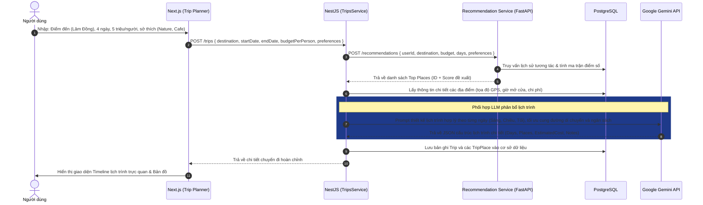

# 🏛️ Tài Liệu Kiến Trúc Hệ Thống (System Architecture Document)
## Nền Tảng AI Travel Planner (Đồ Án Tốt Nghiệp)

Tài liệu thiết kế kiến trúc kỹ thuật toàn diện cho nền tảng **AI Travel Planner**, mô tả mô hình vi dịch vụ lai (Hybrid Microservices), cơ chế lưu trữ quan hệ & vector (pgvector), công nghệ học máy đề xuất (Machine Learning Recommendation) và đường ống xử lý ngôn ngữ tự nhiên RAG (Retrieval-Augmented Generation).

---

## 1. Tổng Quan Kiến Trúc (Architecture Overview)

Hệ thống được xây dựng theo mô hình **Kiến trúc Vi dịch vụ Lai (Hybrid Microservices & Tiered Architecture)** nhằm tối ưu hóa thế mạnh của từng công nghệ:

```
┌────────────────────────────────────────────────────────────────────────┐
│                   CLIENT LAYER (Next.js 16 - Port 3000)                 │
│         Lập lịch trình tour | Chatbot RAG | Khám phá địa điểm           │
└───────────────────────────────────┬────────────────────────────────────┘
                                    │ HTTP / REST / SSE Stream
                                    ▼
┌────────────────────────────────────────────────────────────────────────┐
│              APPLICATION & API GATEWAY (NestJS - Port 3002)            │
│   Auth (JWT) | Trips Engine | Places | Community | RAG Pipeline         │
│               BGE-M3 Local ONNX Vectorizer (1024 dims)                  │
└──────────────────┬─────────────────────────────────┬───────────────────┘
                   │ Internal HTTP                   │ SQL / pgvector
                   ▼                                 ▼
┌──────────────────────────────────────┐  ┌──────────────────────────────┐
│ RECOMMENDATION SERVICE (FastAPI 8000)│  │ POSTGRESQL 16 + PGVECTOR     │
│ Python 3.11 | Matrix Factorization   │  │ Port 5432 (Docker Volume)    │
│ Collaborative Filtering | Scikit-ML  │  │ Quan hệ + Vector Store       │
└──────────────────────────────────────┘  └──────────────────────────────┘
                   │                                 ▲
                   └─────────── Synced Data ─────────┘
```

1. **Presentation Layer (Frontend)**: 
   - Xây dựng trên **Next.js 16 (App Router)**, **React 19**, **Tailwind CSS v4** và bộ biểu tượng **Lucide Icons**.
   - Hỗ trợ trải nghiệm tương tác cao cấp: Lập lịch trình trực quan, Hỏi đáp RAG trực tiếp với SSE streaming, Quản lý phiên hội thoại, Khám phá địa điểm du lịch kèm ảnh và bản đồ.
2. **Application & Orchestration Gateway (Backend - Port 3002)**:
   - Nền tảng **NestJS (TypeScript)** điều phối toàn bộ luồng nghiệp vụ.
   - Module nhúng vector cục bộ (`EmbeddingService`) chạy trực tiếp mô hình **BAAI/bge-m3** (`Xenova/bge-m3` qua `@huggingface/transformers` định dạng ONNX q8 ~570MB).
   - Module giao tiếp CSDL qua **Prisma ORM** với extension **pgvector** cho phép truy vấn quan hệ và tìm kiếm vector tương đồng trên cùng một CSDL.
   - Module sinh ngôn ngữ thông minh (`GeminiService`) tích hợp **Google Gemini 2.0 Flash / 1.5 Flash**.
   - Module điều phối kế hoạch chuyến đi (`TripsService`) kết hợp điểm số đề xuất từ Recommendation Service với LLM Planner.
3. **Machine Learning Recommendation Service (Python/FastAPI - Port 8000)**:
   - Vi dịch vụ chuyên trách tính toán thuật toán gợi ý (Collaborative Filtering & Content-Based Filtering) dựa trên lịch sử tương tác người dùng (view, like, save, rate).
   - Huấn luyện offline và suy luận online trả về top địa điểm phù hợp nhất theo điểm đến, ngân sách và sở thích.
4. **Data & Storage Infrastructure Layer**:
   - Container **PostgreSQL 16** với extension **pgvector** chạy trên Docker Compose.
   - Quản lý tập trung toàn bộ dữ liệu trong thư mục [`datasets/`](file:///z:/Learn_Programming/DATN%20-%20AI%20Travel%20Planner/datasets) (Bản dump SQL 138MB, tập dữ liệu huấn luyện RAG, 420 cặp QA 21 tỉnh thành, 200 cặp QA 5 chủ đề chuyên sâu, và mock dataset).

---

## 2. Sơ Đồ Thành Phần Hệ Thống (Component Diagram)

```mermaid
graph TB
    subgraph Client ["Client Layer (Trình duyệt Người Dùng)"]
        UI_Home["Trang chủ & Khám phá (/places)"]
        UI_Trip["Lập lịch trình (/trips)"]
        UI_RAG["Trợ lý RAG Chat (/question-answer)"]
        UI_Comm["Cộng đồng (/community)"]
    end

    subgraph NestGateway ["NestJS Backend Server (Port 3002)"]
        AuthModule["Auth & Users Module<br>(JWT + Bcrypt)"]
        TripsModule["Trips Module<br>(Itinerary Generator)"]
        PlacesModule["Places & Comments Module"]
        ChatModule["Chat & RAG Module<br>(SSE Streaming, Sessions)"]
        EmbedSvc["EmbeddingService<br>(Local BGE-M3 ONNX 1024d)"]
        PrismaSvc["PrismaService (ORM)"]
        GeminiSvc["GeminiService<br>(Google Gen AI SDK)"]
    end

    subgraph RecService ["Recommendation Service (Port 8000)"]
        RecFastAPI["FastAPI App"]
        RecModel["Collaborative Filtering Engine<br>(Matrix Factorization, Decay Weights)"]
    end

    subgraph DataStorage ["Data & Storage Layer (Docker Compose)"]
        PG["PostgreSQL 16 + pgvector (Port 5432)<br>Users, Places, Trips, Interactions, TourismChunks"]
        LocalModel["Local ONNX Weights Cache<br>(Xenova/bge-m3 ~570MB)"]
        GeminiCloud["Google Gemini Cloud API<br>(gemini-2.0-flash)"]
        DatasetsDir["Folder datasets/<br>tourism_chunks_data.sql<br>qa_21_provinces.json<br>qa_advanced_topics.json"]
    end

    UI_RAG <-->|SSE Stream (Tokens + Sources)| ChatModule
    UI_Trip <-->|REST API| TripsModule
    UI_Home <-->|REST API| PlacesModule
    UI_Comm <-->|REST API| NestGateway

    TripsModule -->|1. Request Top Places| RecFastAPI
    RecFastAPI <-->|Read Interactions & Places| PG
    TripsModule -->|2. Generate Itinerary Prompt| GeminiSvc
    GeminiSvc <-->|Inference| GeminiCloud

    ChatModule --> EmbedSvc
    EmbedSvc <-->|Local Inference| LocalModel
    ChatModule -->|Vector Cosine Search| PrismaSvc
    PrismaSvc <-->|SQL / HNSW Index| PG
    ChatModule -->|Stream Final Answer| GeminiSvc
```

---

## 3. Các Luồng Nghiệp Vụ Chính (Core Execution Flows)

### 3.1 Luồng 1: Lập Lịch Trình Chuyến Đi Tự Động (Trip Planning Flow)



---

### 3.2 Luồng 2: Hỏi Đáp Du Lịch RAG Thời Gian Thực (RAG Q&A Flow)

```mermaid
sequenceDiagram
    autonumber
    actor User as Người dùng
    participant UI as Next.js (/question-answer)
    participant Nest as NestJS (ChatController & RagService)
    participant Embed as EmbeddingService (BGE-M3 Local)
    participant DB as PostgreSQL (pgvector)
    participant Gemini as Google Gemini API

    User->>UI: Chọn chủ đề hoặc nhập câu hỏi: "Cung phượt Măng Đen 3N2Đ đi thế nào?"
    UI->>Nest: POST /api/chat { message, sessionId } (SSE Stream)
    Nest->>DB: Tải lịch sử tin nhắn của phiên (Multi-turn Memory)

    rect rgb(30, 41, 59)
        note over Nest,Embed: Bước 1: Nhúng vector câu hỏi tại chỗ
        Nest->>Embed: embed(query)
        Embed-->>Nest: Vector 1024 chiều (float32 array)
    end

    rect rgb(6, 78, 59)
        note over Nest,DB: Bước 2: Tìm kiếm tương đồng ngữ cảnh trong pgvector
        Nest->>DB: SELECT id, content, metadata, 1 - (embedding <=> query_vec) AS similarity FROM tourism_chunks ORDER BY embedding <=> query_vec LIMIT 5
        DB-->>Nest: Top 5 Chunks phù hợp nhất (QA Chunks + Context Chunks)
    end

    Nest-->>UI: SSE Event: 'sources' kèm danh sách 5 tài liệu và điểm match %
    UI->>UI: Hiển thị khối Nguồn tham chiếu kèm badge độ tin cậy

    rect rgb(30, 58, 138)
        note over Nest,Gemini: Bước 3: Ghép Prompt & Stream câu trả lời
        Nest->>Gemini: generateContentStream(Prompt = System Persona + Contexts + Lịch sử + Câu hỏi)
        loop Token Streaming
            Gemini-->>Nest: Token chunk ("Để ", "khám ", "phá ", "Măng Đen...")
            Nest-->>UI: SSE Event: 'token' { token: "..." }
            UI->>UI: Hiệu ứng gõ chữ thời gian thực
        end
    end

    Nest->>DB: Lưu tin nhắn hỏi & đáp vào ChatMessage của phiên
    Nest-->>UI: SSE Event: 'done' { done: true }
    UI->>User: Hoàn thành hiển thị câu trả lời
```



---

## 4. Thiết Kế Cơ Sở Dữ Liệu & Mô Hình Dữ Liệu

Toàn bộ hệ thống sử dụng chung một cơ sở dữ liệu PostgreSQL 16 (pgvector):

### 4.1 Các Bảng Dữ Liệu Quan Hệ Cốt Lõi
- **`User`**: Tài khoản người dùng, email, mật khẩu mã hóa bcrypt, vai trò (`USER`, `ADMIN`), phong cách ưa thích (`preferredStyles`), mức ngân sách (`budgetLevel`).
- **`Place`**: Danh mục địa điểm du lịch (520+ địa điểm thực tế), tên, mô tả, danh mục (`categories`), tỉnh thành (`province`), mức giá dự tính (`priceEstimate`), điểm phổ biến (`popularityScore`), loại không gian (`indoorOutdoor`), mức độ hoạt động (`activityLevel`), tọa độ GPS (`latitude`, `longitude`), hình ảnh minh họa (`images`).
- **`Trip` & `TripPlace`**: Kế hoạch chuyến đi của người dùng, điểm đến, ngày bắt đầu/kết thúc, tổng ngân sách, số lượng người, trạng thái (`DRAFT`, `GENERATED`, `CONFIRMED`, `COMPLETED`), cấu trúc lịch trình chi tiết JSON (`itinerary`).
- **`UserInteractionEvent`**: Bảng ghi nhận sự kiện hành vi phục vụ hệ thống gợi ý (`VIEW_DETAIL`, `LIKE`, `SAVE`, `REMOVE_SAVE`, `RATE`, `SHARE`), điểm đánh giá (`ratingValue`), phiên làm việc (`sessionId`).
- **`ChatSession` & `ChatMessage`**: Quản lý lịch sử trò chuyện đa lượt, tiêu đề phiên, vai trò (`user`, `assistant`), nội dung tin nhắn, danh sách nguồn trích dẫn (`sources` JSONB).
- **`Comment` & `Post`**: Nền tảng mạng xã hội thu nhỏ cho cộng đồng du lịch, bình luận địa điểm, bài viết chia sẻ kinh nghiệm, lượt thích bài viết.

### 4.2 Bảng Vector Tri Thức RAG (`tourism_chunks`)
```sql
CREATE EXTENSION IF NOT EXISTS vector;

CREATE TABLE IF NOT EXISTS tourism_chunks (
    id VARCHAR(100) PRIMARY KEY,                  -- ID định danh (ví dụ: 'ctx_0_1', 'qa_bac_giang_01', 'qa_route_01')
    chunk_type VARCHAR(20) NOT NULL,              -- 'context' (bài viết) hoặc 'qa' (hỏi đáp)
    content TEXT NOT NULL,                        -- Nội dung văn bản đầy đủ dùng cho truy vấn ngữ cảnh
    embedding vector(1024) NOT NULL,              -- Vector 1024 chiều từ Xenova/bge-m3
    metadata JSONB NOT NULL,                      -- Dữ liệu bổ trợ: province, topic, title, source_file
    created_at TIMESTAMP(3) WITHOUT TIME ZONE DEFAULT CURRENT_TIMESTAMP
);

-- Chỉ mục HNSW tối ưu hóa tìm kiếm Cosine Similarity
CREATE INDEX IF NOT EXISTS idx_tourism_chunks_embedding 
ON tourism_chunks USING hnsw (embedding vector_cosine_ops);

-- Chỉ mục phân loại loại chunk
CREATE INDEX IF NOT EXISTS idx_tourism_chunks_type 
ON tourism_chunks (chunk_type);
```

---

## 5. Tổ Chức Thư Mục Dữ Liệu (`datasets/`)

Toàn bộ tài nguyên dữ liệu tĩnh và bộ nạp được quy hoạch tập trung tại [`datasets/`](file:///z:/Learn_Programming/DATN%20-%20AI%20Travel%20Planner/datasets):

| Tệp Dữ Liệu | Định dạng | Quy mô | Công dụng |
| :--- | :--- | :--- | :--- |
| `tourism_chunks_data.sql` | SQL Dump | 138 MB | Bản sao lưu hoàn chỉnh 10.856+ vector chunks trong pgvector |
| `train_vietnam_tourism.json`<br>`valid_vietnam_tourism.json` | JSON | ~10 MB | Bộ ngữ cảnh bài viết và cặp QA du lịch Việt Nam nguyên bản |
| `qa_21_provinces.json` | JSON | 420 items | 420 cặp QA chính xác về 21 tỉnh thành bổ sung |
| `qa_advanced_topics.json` | JSON | 200 items | 200 cặp QA về 5 chủ đề chuyên sâu (Cung đường, Chi phí, Lưu trú...) |
| `mock_users.json` | JSON | 400 users | Hồ sơ người dùng mô phỏng với đa dạng phong cách |
| `mock_places.json` | JSON | 520 places | Danh mục địa điểm chuẩn hóa đồng bộ cho Recommendation Engine |
| `mock_interactions.json` | JSON | ~7.500 events | Lịch sử tương tác người dùng - địa điểm để huấn luyện mô hình |

---

## 6. Mô Hình AI & Máy Học (AI & ML Stack)

1. **Embedding Model: Xenova/bge-m3 (q8)**:
   - **Chạy hoàn toàn cục bộ (In-process Node.js)** thông qua ONNX Runtime (`@huggingface/transformers`).
   - Lượng tử hóa 8-bit (`q8`), dung lượng chỉ **~570 MB** giúp tiết kiệm RAM và tốc độ suy luận dưới 200ms.
   - Hỗ trợ đa ngữ, khả năng hiểu tiếng Việt ngữ nghĩa chuyên sâu vượt trội.
2. **Generative LLM: Google Gemini API**:
   - Sử dụng mô hình `gemini-2.0-flash` (hoặc `gemini-1.5-flash`) cho thời gian phản hồi cực nhanh (Time to First Token < 1.2s).
   - Tích hợp kỹ thuật Prompt Grounding nghiêm ngặt để loại bỏ ảo giác.
3. **Recommendation Engine (Python/FastAPI)**:
   - Tính điểm tương tác suy giảm theo thời gian (Time-decay Lambda factor).
   - Thuật toán phối hợp sở thích người dùng với đặc trưng địa điểm (Content-based + Collaborative Filtering).

---

## 7. Cấu Hình Cổng Mạng & Docker Compose

```yaml
services:
  postgres:
    image: pgvector/pgvector:pg16
    ports: ["5432:5432"]
    volumes: [pgdata:/var/lib/postgresql/data]

  recommendation-service:
    build: ./recommendation-service
    ports: ["8000:8000"]
    depends_on: [postgres]

  backend:
    build: ./backend
    ports: ["3002:3002"]
    depends_on: [postgres, recommendation-service]
```
*(Frontend Next.js chạy độc lập tại cổng `3000`)*.
