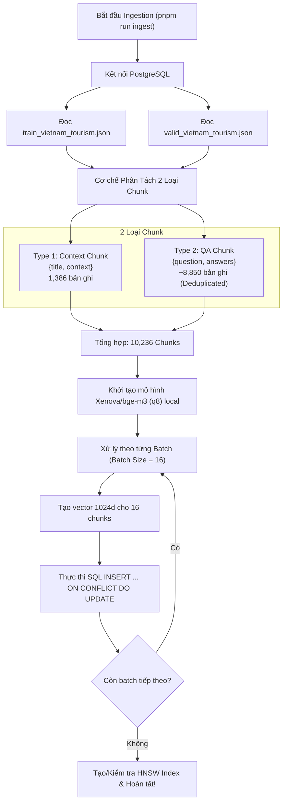

# System Architecture Document
## Hệ Thống Chatbot RAG Du Lịch Việt Nam (100% TypeScript Stack)

Tài liệu thiết kế kiến trúc kỹ thuật toàn diện cho hệ thống Chatbot RAG Du lịch Việt Nam, bao gồm sơ đồ phân tầng, cơ chế lưu trữ vector, quy trình xử lý dữ liệu và luồng thực thi RAG.

---

## 1. Tổng Quan Kiến Trúc (Architecture Overview)

Hệ thống được thiết kế theo mô hình **Kiến trúc phân tầng 3 lớp (3-Tier Layered Architecture)** hiện đại, vận hành **100% bằng TypeScript** và quản lý phụ thuộc độc quyền qua **`pnpm`**:

1. **Presentation Layer (Frontend)**: Ứng dụng **Next.js (App Router)** với giao diện tối ưu tại route `/question-answer`, kết nối và tiêu thụ luồng dữ liệu thời gian thực thông qua Server-Sent Events (SSE).
2. **Application & Orchestration Layer (Backend)**: Nền tảng **NestJS**, tích hợp:
   - Module nhúng vector cục bộ (`EmbeddingService`) chạy trực tiếp mô hình **BAAI/bge-m3** (`Xenova/bge-m3` qua `@huggingface/transformers`).
   - Module giao tiếp CSDL qua **Prisma ORM** với extension **pgvector**.
   - Module sinh câu trả lời thông minh (`GeminiService`) tích hợp **Google Gemini API**.
   - Bộ điều phối RAG Pipeline (`RagService`).
3. **Data & AI Infrastructure Layer**:
   - Container **PostgreSQL 16** với extension **pgvector** chạy trên Docker Compose.
   - Kho trọng số mô hình ONNX BAAI/bge-m3 lưu trữ cục bộ trên máy chủ.
   - Google Gemini Cloud API cho khâu hoàn thiện ngôn ngữ tự nhiên.

---

## 2. Sơ Đồ Kiến Trúc Hệ Thống (System Diagrams)

### 2.1 Sơ Đồ Thành Phần Tổng Thể (Component Diagram)

```mermaid
graph TB
    subgraph Client ["Client Layer (Trình duyệt Người Dùng)"]
        UI["Next.js App (/question-answer)<br>React 19 + Tailwind CSS + Lucide"]
    end

    subgraph Backend ["NestJS Backend Server (Port 3001)"]
        ChatCtrl["ChatController<br>(POST /api/chat - SSE Stream)"]
        RagSvc["RagService<br>(Orchestration & Prompt Builder)"]
        EmbedSvc["EmbeddingService<br>(Local Xenova/bge-m3 ONNX)"]
        PrismaSvc["PrismaService<br>(PrismaClient + Raw Vector SQL)"]
        GeminiSvc["GeminiService<br>(Google Gen AI SDK)"]
        IngestSvc["Ingestion Pipeline<br>(datasets -> chunks -> vectors)"]
    end

    subgraph Storage ["Data & AI Storage"]
        PG["PostgreSQL 16 + pgvector (Docker: 5432)<br>Bảng: tourism_chunks (HNSW Index)"]
        LocalModel["Local ONNX Model Cache<br>(Xenova/bge-m3 ~570MB)"]
        GeminiCloud["Google Gemini Cloud API<br>(gemini-2.0-flash)"]
        Datasets["Dataset Files (JSON)<br>train & valid_vietnam_tourism.json"]
    end

    UI <-->|SSE Stream (Tokens + Citations)| ChatCtrl
    ChatCtrl --> RagSvc
    RagSvc -->|1. Vectorize Query| EmbedSvc
    EmbedSvc <-->|Inference| LocalModel
    RagSvc -->|2. Cosine Search top_k| PrismaSvc
    PrismaSvc <-->|SQL <=>| PG
    RagSvc -->|3. Generate Answer| GeminiSvc
    GeminiSvc <-->|Stream Tokens| GeminiCloud

    IngestSvc -->|Read JSON| Datasets
    IngestSvc -->|Batch Embedding| EmbedSvc
    IngestSvc -->|Batch Upsert| PrismaSvc
```

---

### 2.2 Sơ Đồ Luồng Truy Vấn RAG Thời Gian Thực (RAG Query Sequence Diagram)

```mermaid
sequenceDiagram
    autonumber
    actor User as Người dùng
    participant UI as Next.js Frontend
    participant Nest as NestJS (ChatController)
    participant RAG as RagService
    participant Embed as EmbeddingService (BGE-M3)
    participant DB as PostgreSQL (pgvector)
    participant Gemini as Google Gemini API

    User->>UI: Nhập câu hỏi: "Thủ đô Hà Nội có nét hấp dẫn nào?"
    UI->>Nest: POST /api/chat { message: "..." }
    Nest->>RAG: streamRagAnswer(query)
    
    rect rgb(30, 41, 59)
        note over RAG,Embed: Bước 1: Nhúng vector câu hỏi cục bộ
        RAG->>Embed: embed(query)
        Embed-->>RAG: Vector 1024 chiều (float32 array)
    end

    rect rgb(6, 78, 59)
        note over RAG,DB: Bước 2: Tìm kiếm tương đồng ngữ cảnh
        RAG->>DB: SELECT id, content, 1 - (embedding <=> query_vec) AS similarity FROM tourism_chunks ORDER BY embedding <=> query_vec LIMIT 5
        DB-->>RAG: Danh sách 5 chunks phù hợp nhất (Bài viết + Hỏi đáp)
    end

    RAG-->>Nest: Event { type: 'sources', data: top_chunks }
    Nest-->>UI: SSE: data: {"type": "sources", "data": [...]}
    UI->>UI: Hiển thị thanh "Nguồn tham chiếu (5 tài liệu)" & điểm match %

    rect rgb(30, 58, 138)
        note over RAG,Gemini: Bước 3: Ghép Prompt & Gọi LLM Stream
        RAG->>RAG: Ghép Prompt = Contexts + Quy định an toàn + Câu hỏi
        RAG->>Gemini: generateContentStream(prompt)
        loop Token Streaming
            Gemini-->>RAG: Token chunk ("Thủ ", "đô ", "Hà ", "Nội...")
            RAG-->>Nest: Event { type: 'token', data: "..." }
            Nest-->>UI: SSE: data: {"type": "token", "data": "..."}
            UI->>UI: Hiệu ứng gõ chữ thời gian thực
        end
    end

    RAG-->>Nest: Event { type: 'done', data: true }
    Nest-->>UI: SSE: data: {"type": "done", "data": true}
    UI->>User: Hoàn tất hiển thị câu trả lời & trích dẫn
```



---

### 2.3 Sơ Đồ Nạp Dữ Liệu Tự Động (Ingestion Pipeline)



---

## 3. Thiết Kế Cơ Sở Dữ Liệu & Vector Store

### 3.1 Cấu Hình Docker Compose
Cơ sở dữ liệu được triển khai độc lập thông qua Docker Compose sử dụng image chính thức `pgvector/pgvector:pg16`:
- **Cổng ánh xạ**: `5432:5432`
- **Volume lưu trữ**: `pgdata:/var/lib/postgresql/data` (Bảo toàn dữ liệu bền vững khi tắt mở máy).
- **Extension**: Kích hoạt `vector` thông qua lệnh SQL `CREATE EXTENSION IF NOT EXISTS vector;`.

### 3.2 Schema Bảng `tourism_chunks`
Bảng được định nghĩa đồng bộ giữa Prisma ORM và CSDL PostgreSQL:

```sql
CREATE EXTENSION IF NOT EXISTS vector;

CREATE TABLE IF NOT EXISTS tourism_chunks (
    id VARCHAR(100) PRIMARY KEY,                  -- ID định danh duy nhất (VD: 'ctx_0_1' hoặc QA 'GT_C1_Q8')
    chunk_type VARCHAR(20) NOT NULL,              -- Loại chunk: 'context' (bài viết) hoặc 'qa' (hỏi đáp)
    content TEXT NOT NULL,                        -- Chuỗi văn bản đầy đủ dùng cho truy vấn ngữ cảnh
    embedding vector(1024) NOT NULL,              -- Vector 1024 chiều nhúng từ BAAI/bge-m3
    metadata JSONB NOT NULL,                      -- Dữ liệu bổ trợ: tiêu đề, file nguồn, câu hỏi, câu trả lời
    created_at TIMESTAMP(3) WITHOUT TIME ZONE DEFAULT CURRENT_TIMESTAMP
);

-- Chỉ mục HNSW tối ưu hóa tìm kiếm Cosine Similarity với tốc độ O(log N)
CREATE INDEX IF NOT EXISTS idx_tourism_chunks_embedding 
ON tourism_chunks USING hnsw (embedding vector_cosine_ops);

-- Chỉ mục Btree hỗ trợ lọc theo loại chunk
CREATE INDEX IF NOT EXISTS idx_tourism_chunks_type 
ON tourism_chunks (chunk_type);
```

### 3.3 Định Nghĩa trong Prisma Schema (`backend/prisma/schema.prisma`)
Prisma 6 hỗ trợ quản lý kiểu vector PostgreSQL thông qua kiểu dữ liệu `Unsupported`:

```prisma
datasource db {
  provider   = "postgresql"
  url        = env("DATABASE_URL")
  extensions = [pgvector(map: "vector")]
}

generator client {
  provider        = "prisma-client-js"
  previewFeatures = ["postgresqlExtensions"]
}

model TourismChunk {
  id        String   @id
  chunkType String   @map("chunk_type") @db.VarChar(20)
  content   String   @db.Text
  embedding Unsupported("vector(1024)")
  metadata  Json     @db.JsonB
  createdAt DateTime @default(now()) @map("created_at")

  @@index([chunkType], map: "idx_tourism_chunks_type")
  @@map("tourism_chunks")
}
```

---

## 4. Mô Hình Embedding BAAI/bge-m3 Chạy Local

### 4.1 Tại Sao Chọn BAAI/bge-m3?
- **Hỗ trợ tiếng Việt xuất sắc**: BGE-M3 (Multilingual, Multi-Functionality, Multi-Granularity) được huấn luyện trên hơn 100 ngôn ngữ, là một trong những mô hình embedding tiếng Việt mạnh mẽ nhất hiện nay.
- **Chiều vector**: `1024` chiều, đủ giàu ngữ nghĩa để phân biệt các sắc thái văn hóa và địa danh du lịch.
- **Độ dài ngữ cảnh tối đa**: Lên đến `8,192` tokens.

### 4.2 Triển Khai Chạy Local Trong Node.js
- Mô hình được chạy thông qua thư viện `@huggingface/transformers` với định dạng ONNX `Xenova/bge-m3`.
- **Cấu hình lượng tử hóa (Quantization)**: Sử dụng bản **`q8` (`model_quantized.onnx`)** với dung lượng chỉ **~570 MB** (so với 2.27 GB của bản gốc fp32), giúp giảm 75% dung lượng tải và tăng tốc độ suy luận gấp 3 lần mà không suy giảm chất lượng tìm kiếm tương đồng.
- **Chiến lược Pooling**: `pooling: 'cls'`, kết hợp `normalize: true` giúp các vector chuẩn hóa về độ dài đơn vị (Unit Vector), cho phép phép tính Cosine Similarity tương đương với phép nhân vô hướng (Dot Product).

---

## 5. RAG Pipeline & Tích Hợp Google Gemini API

### 5.1 Quy Trình Tìm Kiếm Ngữ Cảnh (Retrieval Step)
1. Câu hỏi của người dùng được chuẩn hóa và truyền qua `EmbeddingService.embed(query)`.
2. Truy vấn SQL tính toán khoảng cách cosine (`<=>`):
   ```sql
   SELECT id, chunk_type, content, metadata, 
          1 - (embedding <=> $1::vector) AS similarity
   FROM tourism_chunks
   ORDER BY embedding <=> $1::vector
   LIMIT 5;
   ```
3. Lấy top 5 kết quả có độ tương đồng cao nhất. Sự kết hợp giữa 2 loại chunk mang lại hiệu quả vượt trội:
   - Nếu câu hỏi trùng hoặc gần khớp với 1 câu hỏi mẫu trong dataset, QA chunk sẽ đạt độ khớp rất cao (> 90%).
   - Context chunk cung cấp toàn bộ đoạn văn bản ngữ cảnh xung quanh để AI có thêm chi tiết phong phú.

### 5.2 Xây Dựng Prompt Kỹ Thuật (Augmentation Step)
Prompt được định dạng nghiêm ngặt để đảm bảo AI hoạt động với vai trò chuyên gia du lịch và triệt tiêu hoàn toàn ảo giác:
- Quy định vai trò rõ ràng: "Cố Vấn Du Lịch Việt Nam AI".
- Đưa toàn bộ 5 tài liệu vào phần `TÀI LIỆU THAM KHẢO` kèm nhãn phân loại và điểm match %.
- Yêu cầu AI chỉ trả lời dựa trên tài liệu, lịch sự từ chối hoặc thông báo giới hạn tri thức nếu câu hỏi không liên quan đến du lịch Việt Nam.

### 5.3 Sinh & Stream Câu Trả Lời (Generation Step)
- Sử dụng SDK `@google/genai` với mô hình `gemini-2.0-flash` (hoặc `gemini-1.5-flash`).
- Phản hồi dạng Stream: Controller NestJS thiết lập header `text/event-stream` và truyền trực tiếp từng token về trình duyệt người dùng qua SSE.

---

## 6. Bảo Mật & Quản Trị Hệ Thống

- **Bảo vệ API Key**: Khóa `GEMINI_API_KEY` được bảo mật hoàn toàn ở tầng backend thông qua file `.env`, không bao giờ bị lộ ra ngoài client.
- **CORS Policy**: Backend NestJS chỉ chấp nhận các yêu cầu hợp lệ từ frontend (`http://localhost:3000`).
- **Validation Pipe**: DTO được kiểm tra nghiêm ngặt với `class-validator` để loại bỏ các payload rác hoặc tấn công chèn mã.
