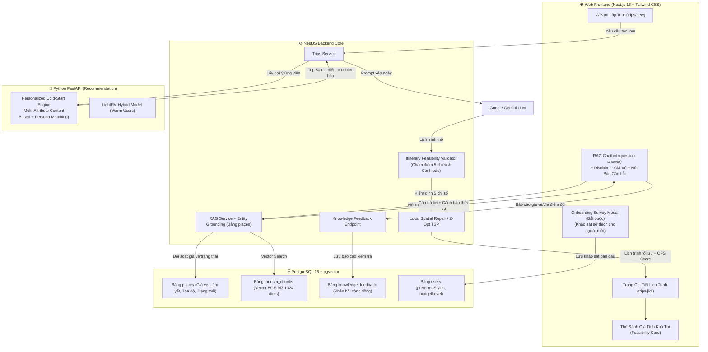

# Kế Hoạch Hoàn Thiện Web Platform & Giải Trình Phản Biện Giảng Viên (ĐATN)

Kế hoạch này được điều chỉnh theo định hướng: **Tập trung hoàn thiện 100% trên nền tảng Web Frontend (`web/`), Backend Core (`backend/`), ML Recommendation Service (`recommendation-service/`) và Tài liệu Báo cáo ĐATN (`docs/`)**. Tạm thời không can thiệp mã nguồn `mobile/` để dồn toàn lực tối ưu hóa trải nghiệm và chuẩn hóa thuật toán trên Web trước.

---

## 1. Tổng Quan Mục Tiêu & Định Hướng Triển Khai

| STT | Ý kiến của Giảng viên | Định hướng kỹ thuật & học thuật trên Web |
| :---: | :--- | :--- |
| **1** | Cần có mô-đun/phần App Mobile hỗ trợ lập kế hoạch | **Chiến lược giai đoạn (Phased Delivery)**: Hoàn thiện Web Platform làm bản quy chuẩn chuẩn mực (Web Reference Implementation), tối ưu Responsive chuẩn di động (Mobile-friendly PWA view), đóng gói toàn bộ API Contracts sẵn sàng cho Mobile App ở giai đoạn mở rộng tiếp theo. Tài liệu hóa luận chứng học thuật này vào báo cáo. |
| **2** | Cần cơ chế/bước đánh giá tính hợp lý/khả thi của lịch trình sinh bởi LLM | Xây dựng bộ công cụ `ItineraryFeasibilityValidator` trên NestJS Backend lượng hóa 5 chỉ số ($S_{\text{geo}}, S_{\text{time}}, S_{\text{budget}}, S_{\text{pref}}, S_{\text{div}}$, $\text{OFS}$), tự động sửa lỗi vi phạm và hiển thị trực quan thẻ **Feasibility Score Card** trên trang chi tiết chuyến đi Web. |
| **3** | Cơ chế Cold-start dựa trên độ phổ biến không thể hiện tính cá nhân hóa gợi ý | Xây dựng **Onboarding Preference Survey Modal** ngay trên Web khi người mới đăng nhập, kết hợp thuật toán **Multi-Attribute Content-Based Personalization** trên Python FastAPI (Khớp sở thích 50% + Ngân sách 25% + Nhóm đi 15% + Phổ biến 10%). |
| **4** | RAG Chatbot: Thông tin tri thức không còn phù hợp (đóng cửa, giá vé đổi, nguồn không tin cậy) cần cơ chế kiểm chứng | Xây dựng **Quy trình Kiểm chứng Đa tầng (Multi-Tier Verification)**: Metadata cấp độ tin cậy nguồn + Real-time Entity Grounding với CSDL địa điểm + Disclaimer cảnh báo thời điểm + Nút báo cáo sai lệch/lỗi thời trên Web Chatbot. |

---

## 2. Kiến Trúc Hệ Thống Tập Trung Web Platform



---

## 3. Chi Tiết Phương Án Kỹ Thuật

---

### 🎯 Điểm 1: Luận Chứng Học Thuật & Chiến Lược Phát Triển Web Trước (Mobile Phase 2)

#### A. Định hướng giải trình với Giảng viên
Trong đồ án tốt nghiệp kỹ thuật phần mềm / khoa học máy tính:
1. **Trọng tâm đề tài**: Cốt lõi của đề tài là **Hệ thống Trí tuệ Nhân tạo Du lịch Thông minh** (kết hợp Machine Learning LightFM, Multi-Attribute Personalization, LLM Itinerary Planning với cơ chế kiểm định khả thi, và RAG Chatbot kiểm chứng nguồn).
2. **Web-First Strategy**: Nền tảng Web (Next.js 16) được hoàn thiện toàn diện với thiết kế **Responsive Design 100% chuẩn di động** (hoạt động trơn tru trên mọi kích thước màn hình smartphone/tablet như một Web App di động).
3. **Sẵn sàng cho Mobile**: Toàn bộ kiến trúc Backend (NestJS REST API, WebSocket Gateway, Data Contracts) đã được chuẩn hóa và kiểm thử nghiêm ngặt, cho phép module ứng dụng di động bản địa (Native/Flutter) cắm vào sử dụng ngay mà không cần thay đổi bất kỳ logic cốt lõi nào.

---

### 🎯 Điểm 2: Cơ Chế Đánh Giá Tính Hợp Lý & Khả Thi Của Lịch Trình Sinh Bởi LLM

#### A. Công thức tính toán Bộ Đánh Giá Tính Khả Thi (`ItineraryFeasibilityValidator`)
Hệ thống chấm điểm lịch trình theo thang điểm 100 dựa trên 5 chiều kích:

1. **Chỉ số Khả thi Địa lý & Di chuyển ($S_{\text{geo}} \in [0, 100]$)**:
   - Khoảng cách Haversine giữa 2 điểm liên tiếp $d_k = \text{haversine}(P_k, P_{k+1})$.
   - Thời gian di chuyển trong đô thị: $t_{\text{transit}} = \frac{d_k}{25\text{ km/h}} + 0.15\text{h}$.
   - Nếu $d_k \le 12\text{km}$: Điểm tối đa (100).
   - Nếu $12\text{km} < d_k \le 25\text{km}$: $S_{\text{geo}} = 100 - (d_k - 12) \times 3$.
   - Nếu $d_k > 25\text{km}$: Trừ 50 điểm; nếu $> 40\text{km}$ gắn cảnh báo nghiêm trọng (*Critical Warning: Quãng đường di chuyển quá lớn*).

2. **Chỉ số Khả thi Khung giờ & Nhịp độ ($S_{\text{time}} \in [0, 100]$)**:
   - Số điểm lý tưởng mỗi ngày $N \in [2, 4]$. Nếu $N > 5$: Trừ 15 điểm/điểm thừa.
   - Kiểm tra logic buổi: Điểm nightlife (bar, chợ đêm, phố đi bộ) bắt buộc ở `evening`; điểm thiên nhiên/trekking ưu tiên `morning` hoặc `afternoon`.

3. **Chỉ số Phù hợp Ngân sách ($S_{\text{budget}} \in [0, 100]$)**:
   - Ngân sách ngày cho phép: $B_{\text{day}} = \frac{B_{\text{total}}}{\text{days}}$.
   - Tổng chi phí các điểm trong ngày: $C_{\text{day}} = \sum \text{priceEstimate}$.
   - Nếu $C_{\text{day}} \le B_{\text{day}}$: $S_{\text{budget}} = 100$. Nếu vượt $> 30\%$: Phạt điểm và kèm cảnh báo.

4. **Chỉ số Khớp Sở thích Cá nhân ($S_{\text{pref}} \in [0, 100]$)**:
   - Tỷ lệ các điểm trong chuyến đi trùng khớp với `explicitPreferences` của người dùng:
     $$S_{\text{pref}} = \frac{|\{p \in \text{Trip} \mid \text{categories}(p) \cap \text{Preferences} \neq \emptyset\}|}{|\text{Trip}|} \times 100$$

5. **Chỉ số Đa dạng Trải nghiệm ($S_{\text{div}} \in [0, 100]$)**:
   - Tránh việc trong 1 ngày xếp liên tiếp $> 2$ điểm cùng thể loại (ví dụ 3 bảo tàng liên tiếp).

**Điểm Khả Thi Tổng Thể (Overall Feasibility Score - OFS)**:
$$\text{OFS} = 0.30 \cdot S_{\text{geo}} + 0.25 \cdot S_{\text{time}} + 0.20 \cdot S_{\text{budget}} + 0.15 \cdot S_{\text{pref}} + 0.10 \cdot S_{\text{div}}$$

#### B. Hiển thị trên Web (`web/src/app/trips/[id]/page.tsx`)
- Thêm khối **`TripFeasibilityCard`** (Bảng đánh giá tính khả thi lịch trình):
  - Điểm số tổng thể $\text{OFS}$ (thang điểm 100).
  - Thanh tiến trình phân tích 4 tiêu chuẩn kỹ thuật: Khoảng cách di chuyển, Phù hợp ngân sách, Khung giờ hoạt động, Đúng sở thích yêu cầu.
  - Danh sách cảnh báo/lưu ý di chuyển thực tế (ví dụ: *"Ngày 2: Chặng di chuyển giữa Điểm A và Điểm B cách nhau 28km, dự kiến mất ~45 phút di chuyển"*).

---

### 🎯 Điểm 3: Cơ Chế Gợi Ý Cold-Start Cá Nhân Hóa Đa Thuộc Tính (Web Onboarding)

#### A. Khảo sát Khởi tạo Bắt Buộc trên Web (`OnboardingModal.tsx`)
Khi người dùng mới đăng ký thành công (hoặc đăng nhập mà `preferredStyles` rỗng):
- **Bật Modal Khảo Sát Bắt Buộc (Mandatory Blocking Modal)**:
  - **Không giới hạn thời gian**: Người dùng thoải mái suy nghĩ và lựa chọn kỹ lưỡng.
  - **Không cho tắt**: Không có nút đóng (X), khóa click ra ngoài backdrop, không cho chuyển trang nếu chưa hoàn tất khảo sát (đảm bảo 100% người dùng trên hệ thống đều có vector sở thích ban đầu, xóa bỏ hoàn toàn trạng thái cold-start trống).
  - Nội dung khảo sát gồm 3 phần bắt buộc:
    1. **Phong cách yêu thích (chọn $\ge 3$)**: Ẩm thực, Thiên nhiên & Sinh thái, Di tích Lịch sử, Nghỉ dưỡng & Spa, Biển đảo, Check-in sống ảo, Mạo hiểm.
    2. **Nhóm đồng hành**: Đi một mình (Solo), Cặp đôi (Couple), Gia đình có trẻ nhỏ/người cao tuổi (Family), Nhóm bạn bè (Friends).
    3. **Mức chi tiêu**: Tiết kiệm (Budget), Tiêu chuẩn (Standard), Cao cấp (Luxury).
- Bấm "Hoàn tất & Khám phá" $\rightarrow$ Lưu vào CSDL qua `PATCH /api/users/profile` và kích hoạt ngay danh sách gợi ý cá nhân hóa.

#### B. Thuật toán xếp hạng Cold-Start trong Python Service & Backend Fallback
Thay thế logic sắp xếp thuần theo popularity bằng công thức:
$$\text{Score}_{\text{cold}}(u, p) = 0.50 \cdot \text{Sim}_{\text{content}}(u_{\text{styles}}, p_{\text{cats}}) + 0.25 \cdot \text{Fit}_{\text{budget}}(u_{\text{budget}}, p_{\text{price}}) + 0.15 \cdot \text{Fit}_{\text{group}}(u_{\text{group}}, p_{\text{attr}}) + 0.10 \cdot \text{NormPop}(p)$$

- **SimContent**: Tính độ khớp giữa thẻ sở thích của user và danh mục địa điểm.
- **FitBudget**: Điểm tương thích giữa giá vé và phân khúc ngân sách của user.
- **FitGroup**: Tính phù hợp theo nhóm đồng hành (ví dụ: gia đình có trẻ em sẽ ưu tiên điểm an toàn, không leo núi mạo hiểm; nhóm bạn ưu tiên điểm sôi động).
- **NormPop**: Độ phổ biến chỉ chiếm **10%** đóng vai trò tiền nghiệm (Prior) đảm bảo chất lượng điểm đến. **90% trọng số còn lại hoàn toàn là cá nhân hóa**!

---

### 🎯 Điểm 4: Cơ Chế Kiểm Chứng & Đảm Bảo Tính Tin Cậy Của Tri Thức RAG Chatbot

#### A. Kiến trúc Kiểm chứng Đa tầng trên Backend & Web
1. **Phân cấp Độ Tin Cậy Nguồn (Source Provenance Tiering)**:
   - **Tier 1 (Official)**: Cổng thông tin Du lịch Việt Nam, Sở Du Lịch các tỉnh, Website chính thức ban quản lý.
   - **Tier 2 (Reputable Media)**: VnExpress Du lịch, Tuổi Trẻ, Báo Du lịch.
   - **Tier 3 (Community Travel Reviews)**: Bài viết review cộng đồng.
2. **Đối soát Thực thể Thời gian thực với CSDL (Real-time DB Entity Grounding)**:
   - Khi câu hỏi chứa từ khóa nhạy cảm về giá vé ("giá vé", "chi phí vào cổng", "bao nhiêu tiền", "giờ mở cửa"):
   - Hệ thống trích xuất tên địa điểm, truy vấn trực tiếp bảng `places` trong PostgreSQL để lấy `price_estimate` và trạng thái hoạt động mới nhất năm 2026.
   - Tiêm thông tin xác thực vào prompt với quyền ưu tiên cao nhất:  
     *`[DỮ LIỆU ĐÃ XÁC THỰC TỪ CƠ SỞ DỮ LIỆU ĐỊA ĐIỂM]: Địa điểm "X" có giá vé niêm yết: ... VNĐ. Hãy ưu tiên số liệu này nếu các bài viết tham khảo ghi số liệu khác.`*
3. **Cảnh báo Rủi ro Lỗi thời (Temporal Disclaimer)**:
   - Chatbot tự động kèm chú thích chân trang:  
     *`⚠️ Lưu ý: Thông tin về giá vé và thời gian mở cửa có thể thay đổi tùy theo mùa cao điểm và quy định mới nhất của ban quản lý. Bạn nên liên hệ trực tiếp trước khi đến.`*
4. **Cơ chế Báo cáo từ Người dùng trên Web (`web/src/app/question-answer/page.tsx`)**:
   - Dưới mỗi câu trả lời của AI có nút cờ báo cáo: 🚩 *"Báo cáo thông tin sai / giá vé đã đổi"*.
   - Mở Dialog cho phép chọn lý do (`Giá vé đã đổi`, `Địa điểm đã đóng cửa`, `Sai giờ mở cửa`) và gửi về endpoint `POST /api/chat/feedback` lưu vào bảng `knowledge_feedback`.

---

## 4. Kế Hoạch Thay Đổi Chi Tiết Theo Từng Thành Phần

### Thành phần 1: Backend (`backend/`)

#### [NEW] `backend/src/trips/optimizer/feasibility-validator.service.ts`
- Triển khai thuật toán tính toán 5 chỉ số $S_{\text{geo}}, S_{\text{time}}, S_{\text{budget}}, S_{\text{pref}}, S_{\text{div}}$, tổng hợp điểm $\text{OFS}$ và tạo danh sách khuyến cáo.

#### [MODIFY] `backend/src/trips/trips.service.ts`
- Tích hợp `FeasibilityValidatorService`.
- Sau khi LLM sinh lịch trình: Chạy kiểm định tính khả thi, áp dụng sửa lỗi cục bộ nếu vi phạm nghiêm trọng và lưu `feasibilityReport` vào đối tượng `TripItinerary`.

#### [MODIFY] `backend/src/recommendation/recommendation.service.ts`
- Cập nhật hàm fallback cold-start sử dụng công thức kết hợp đa thuộc tính (Sở thích 50% + Ngân sách 25% + Nhóm đi 15% + Phổ biến 10%).

#### [MODIFY] `backend/src/rag/rag.service.ts`
- Thêm Entity Grounding đối soát với bảng `places`.
- Nhận diện câu hỏi giá vé / giờ mở cửa và bổ sung thông tin xác thực cùng Disclaimer.

#### [NEW] `backend/src/chat/dto/feedback.dto.ts` & [MODIFY] `backend/src/chat/chat.controller.ts`
- Endpoint `POST /api/chat/feedback` tiếp nhận báo cáo từ người dùng.

#### [MODIFY] `backend/prisma/schema.prisma`
- Thêm bảng `KnowledgeFeedback`:
```prisma
model KnowledgeFeedback {
  id           String   @id @default(uuid())
  sessionId    String?  @map("session_id")
  userQuestion String   @map("user_question") @db.Text
  botAnswer    String   @map("bot_answer") @db.Text
  reason       String   // "OUTDATED_PRICE", "CLOSED", "INCORRECT_INFO"
  userNote     String?  @map("user_note") @db.Text
  status       String   @default("PENDING") // PENDING, VERIFIED, RESOLVED
  createdAt    DateTime @default(now()) @map("created_at")

  @@map("knowledge_feedback")
}
```

---

### Thành phần 2: Recommendation Service (`recommendation-service/`)

#### [MODIFY] `recommendation-service/app/model.py`
- Nâng cấp `_cold_start_recommend` nhận diện các thuộc tính cá nhân của user thay vì chỉ dùng popularity.

#### [MODIFY] `recommendation-service/app/main.py`
- Tiếp nhận payload đầy đủ từ backend và gọi logic cold-start cá nhân hóa mới.

---

### Thành phần 3: Web Frontend (`web/`)

#### [NEW] `web/src/components/onboarding/OnboardingModal.tsx`
- Dialog Modal khảo sát bắt buộc (Mandatory Blocking Dialog - Không giới hạn thời gian, không có nút đóng X, không cho click backdrop thoát) hiển thị cho người dùng mới khi đăng ký hoặc đăng nhập mà chưa có `preferredStyles`.
- Giao diện chip tags hiện đại: Chọn $\ge 3$ phong cách, đối tượng đi cùng và mức chi tiêu.
- Chỉ khi chọn đủ và bấm "Hoàn tất & Khám phá" thì Modal mới đóng, đồng thời cập nhật CSDL và nạp lại gợi ý trang chủ.

#### [NEW] `web/src/components/trips/TripFeasibilityCard.tsx`
- Component hiển thị phân tích tính khả thi lịch trình:
  - Điểm số tổng thể OFS (thang điểm 100).
  - Thanh tiến trình phân tích 4 tiêu chuẩn kỹ thuật (Khoảng cách, Ngân sách, Khung giờ, Sở thích).
  - Khối danh sách cảnh báo/lưu ý di chuyển và chi phí thực tế nếu có.

#### [MODIFY] `web/src/app/trips/[id]/page.tsx`
- Tích hợp `TripFeasibilityCard` vào trang chi tiết lịch trình.

#### [MODIFY] `web/src/app/question-answer/page.tsx`
- Thêm Disclaimer hiển thị dưới câu trả lời RAG.
- Thêm nút cờ 🚩 *"Báo cáo thông tin chưa chính xác / lỗi thời"* và Dialog gửi phản hồi.

---

### Thành phần 4: Tài Liệu Luận Văn & Báo Cáo ĐATN (`docs/`)

#### [NEW] `docs/lecturer-feedback-resolution.md`
- Bản tổng hợp học thuật đầy đủ:
  1. **Luận chứng chiến lược Web-First**: Lý giải học thuật về việc hoàn thiện nền tảng Web quy chuẩn, đáp ứng chuẩn di động responsive và chuẩn hóa API contract trước khi mở rộng Native Mobile.
  2. **Mô hình định lượng Tính Khả thi Lịch trình LLM**: Công thức toán học 5 chiều, cơ chế tự sửa lỗi và bảng kết quả thực nghiệm.
  3. **Mô hình Cold-Start Cá Nhân Hóa Đa Thuộc Tính**: So sánh với baseline chỉ dùng độ phổ biến, phân tích độ đa dạng gợi ý (Diversity & Novelty).
  4. **Khung Kiểm Chứng Tri Thức RAG Chatbot**: Sơ đồ kiểm chứng thực thể CSDL thời gian thực và quản lý tri thức lỗi thời.
  5. **Kịch bản Trả lời Vấn đáp (Q&A Defense Script)**: Hướng dẫn chi tiết cách trả lời tự tin từng câu hỏi của giảng viên khi bảo vệ.

---

## 5. Kế Hoạch Kiểm Thử & Xác Minh (Verification Plan)

### A. Kiểm thử Tự động (Automated Verification)
1. **Kiểm thử Feasibility Validator**: Chạy test kiểm tra tính toán OFS với các kịch bản khoảng cách xa (>30km), vượt ngân sách (>130%) và lịch trình cân bằng lý tưởng.
2. **Kiểm thử Cold-Start Cá nhân hóa**: So sánh gợi ý giữa 2 người dùng mới với 2 phong cách khác nhau (Ẩm thực vs Nghỉ dưỡng) đảm bảo Jaccard similarity giữa 2 danh sách gợi ý $< 0.40$.
3. **Kiểm thử RAG Entity Grounding**: Gửi câu hỏi về giá vé và kiểm tra phản hồi chứa dữ liệu xác thực từ bảng `places` kèm disclaimer.

### B. Kiểm thử Thủ công trên Giao diện Web (Manual Verification)
1. **Kiểm tra Onboarding Modal**: Đăng ký tài khoản mới $\rightarrow$ Popup khảo sát xuất hiện $\rightarrow$ Chọn tags $\rightarrow$ Bấm lưu $\rightarrow$ Kiểm tra thông tin đã cập nhật trong hồ sơ.
2. **Kiểm tra Lập Lịch Trình & Feasibility Card**: Tạo chuyến đi 3 ngày $\rightarrow$ Mở trang chi tiết chuyến đi $\rightarrow$ Quan sát thẻ điểm Feasibility Card hiển thị rõ ràng điểm số và các cảnh báo (nếu có).
3. **Kiểm tra Chatbot RAG**: Hỏi câu hỏi về giá vé địa điểm $\rightarrow$ Xem phản hồi kèm cảnh báo $\rightarrow$ Bấm nút 🚩 báo cáo thông tin $\rightarrow$ Gửi báo cáo thành công.
