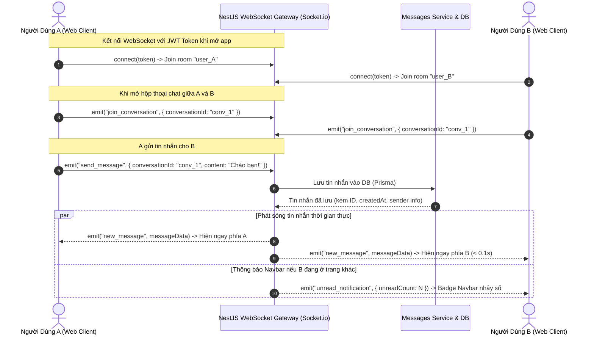

# Kế Hoạch Triển Khai (Cập Nhật WebSocket): Nâng Cấp Cộng Đồng & Nhắn Tin Real-time 1-1

Tài liệu thiết kế kỹ thuật này đã được cập nhật toàn diện theo yêu cầu chuyển sang kiến trúc **Real-time WebSocket (Socket.io)**:
1. **Lưu trữ ảnh chuẩn URL**: Upload file ảnh lưu tại server `backend/uploads/` trả về URL tĩnh + Cho phép dán URL ảnh trực tiếp. Tối ưu hiệu năng, không làm nặng Database như Base64.
2. **Đính kèm lịch trình thông minh theo 2 Kịch bản**:
   - **Kịch bản A (Sắp đi - Tìm bạn đồng hành ghép đoàn)**: Nhận diện ngày đi trong tương lai / tag `#Tìm bạn đồng hành` -> Hiển thị badge **"🟢 Sắp khởi hành [dd/mm/yyyy]"**, số người, dự trù kinh phí -> Nút hành động ưu tiên: **"Nhắn tin tham gia"** (kết nối trực tiếp vào Chat Real-time với tin nhắn mồi thông minh).
   - **Kịch bản B (Đã đi về - Chia sẻ kinh nghiệm / Review)**: Hiển thị tóm tắt điểm check-in -> Nút hành động: **"Xem chi tiết"** và **"Nhân bản chuyến đi" (1-click Clone Trip)** để người khác lưu về dùng.
   - **Bảo mật quyền riêng tư**: Chuyến đi luôn ở chế độ Read-only với người khác, chuyến đi gốc của tác giả không bao giờ bị thay đổi.
3. **Phân quyền Chỉnh sửa / Xóa bài viết của chính mình**: Tác giả bài viết hoặc Admin có toàn quyền sửa/xóa bài đăng của mình.
4. **Hệ thống Nhắn tin Real-time 1-1 qua WebSocket (Socket.io)**: 
   - Sử dụng **NestJS WebSocketGateway** (`@nestjs/websockets`, `@nestjs/platform-socket.io`, `socket.io`).
   - Phía Web client dùng **`socket.io-client`**.
   - Tin nhắn truyền đi **tức thì dưới 0.1 giây**, không cần đợi Polling.
   - Live notification: Huy hiệu tin nhắn chưa đọc trên Navbar nhảy số ngay trong tích tắc khi có tin mới.
   - Hỗ trợ thêm trạng thái phòng chat (Rooms), hiển thị "đang soạn tin nhắn..." (Typing indicator) và trạng thái online.

---

## 1. Kiến Trúc Real-Time WebSocket & Luồng Hoạt Động



---

## 2. Chi Tiết Các Hạng Mục Kỹ Thuật

### A. Cài Đặt Thư Viện WebSocket
1. **Phía Backend (`backend/`)**:
   ```powershell
   cd "z:\Learn_Programming\DATN - AI Travel Planner\backend"
   pnpm add @nestjs/websockets @nestjs/platform-socket.io socket.io
   ```
2. **Phía Frontend (`web/`)**:
   ```powershell
   cd "z:\Learn_Programming\DATN - AI Travel Planner\web"
   pnpm add socket.io-client
   ```

---

### B. Database Layer: Cập Nhật Prisma Schema
**File:** [`backend/prisma/schema.prisma`](file:///z:/Learn_Programming/DATN%20-%20AI%20Travel%20Planner/backend/prisma/schema.prisma)

1. Cập nhật model `CommunityPost`:
```prisma
model CommunityPost {
  id         String   @id @default(uuid())
  userId     String   @map("user_id")
  title      String
  content    String   @db.Text
  images     String[] @default([])
  tags       String[] @default([])
  tripId     String?  @map("trip_id")
  likesCount Int      @default(0) @map("likes_count")
  createdAt  DateTime @default(now()) @map("created_at")
  updatedAt  DateTime @updatedAt @map("updated_at")

  user     User               @relation(fields: [userId], references: [id], onDelete: Cascade)
  trip     Trip?              @relation(fields: [tripId], references: [id], onDelete: SetNull)
  comments CommunityComment[]
  likes    PostLike[]

  @@index([userId])
  @@index([tripId])
  @@index([createdAt])
  @@map("community_posts")
}
```

2. Cập nhật model `Trip`:
```prisma
model Trip {
  // ... các trường hiện tại
  communityPosts CommunityPost[]
}
```

3. Thêm model `Conversation` và `DirectMessage` cho Chat:
```prisma
model Conversation {
  id            String    @id @default(uuid())
  user1Id       String    @map("user1_id")
  user2Id       String    @map("user2_id")
  lastMessageAt DateTime  @default(now()) @map("last_message_at")
  createdAt     DateTime  @default(now()) @map("created_at")
  updatedAt     DateTime  @updatedAt @map("updated_at")

  user1         User      @relation("User1Conversations", fields: [user1Id], references: [id], onDelete: Cascade)
  user2         User      @relation("User2Conversations", fields: [user2Id], references: [id], onDelete: Cascade)
  messages      DirectMessage[]

  @@unique([user1Id, user2Id])
  @@index([user1Id])
  @@index([user2Id])
  @@index([lastMessageAt])
  @@map("conversations")
}

model DirectMessage {
  id             String       @id @default(uuid())
  conversationId String       @map("conversation_id")
  senderId       String       @map("sender_id")
  content        String       @db.Text
  isRead         Boolean      @default(false) @map("is_read")
  createdAt      DateTime     @default(now()) @map("created_at")

  conversation   Conversation @relation(fields: [conversationId], references: [id], onDelete: Cascade)
  sender         User         @relation(fields: [senderId], references: [id], onDelete: Cascade)

  @@index([conversationId])
  @@index([senderId])
  @@index([createdAt])
  @@map("direct_messages")
}
```

---

### C. Backend: Module WebSocket Gateway & Messages Service
**Thư mục mới:** `backend/src/messages/`
- [NEW] [`backend/src/messages/messages.gateway.ts`](file:///z:/Learn_Programming/DATN%20-%20AI%20Travel%20Planner/backend/src/messages/messages.gateway.ts):
  - Định nghĩa `@WebSocketGateway({ cors: { origin: '*' } })`.
  - Quản lý sự kiện:
    - `handleConnection(client)`: Giải mã JWT token từ client handshake để xác định `userId`, tự động đưa socket vào phòng riêng `user_${userId}`.
    - `@SubscribeMessage('join_conversation')`: Đưa socket vào phòng `conversation_${conversationId}`.
    - `@SubscribeMessage('leave_conversation')`: Rời khỏi phòng `conversation_${conversationId}`.
    - `@SubscribeMessage('send_message')`: 
      1. Lưu tin nhắn vào DB qua `MessagesService`.
      2. Phát sóng sự kiện `new_message` đến phòng `conversation_${conversationId}` (tất cả ai đang mở khung chat đều thấy ngay).
      3. Phát sóng sự kiện `unread_notification` đến phòng cá nhân của người nhận `user_${recipientId}` để cập nhật badge số tin nhắn trên Navbar.
    - `@SubscribeMessage('typing')`: Gửi tín hiệu người kia "đang soạn tin nhắn..." đến phòng chat.
- [NEW] [`backend/src/messages/messages.service.ts`](file:///z:/Learn_Programming/DATN%20-%20AI%20Travel%20Planner/backend/src/messages/messages.service.ts):
  - Hàm lưu tin nhắn, lấy lịch sử hội thoại, đếm số tin nhắn chưa đọc, tạo/lấy conversation giữa 2 người.
- [NEW] [`backend/src/messages/messages.controller.ts`](file:///z:/Learn_Programming/DATN%20-%20AI%20Travel%20Planner/backend/src/messages/messages.controller.ts):
  - Hỗ trợ REST API bổ trợ (Lấy danh sách các cuộc hội thoại cũ khi mới vào trang, lấy thông tin ban đầu).
- [NEW] [`backend/src/messages/messages.module.ts`](file:///z:/Learn_Programming/DATN%20-%20AI%20Travel%20Planner/backend/src/messages/messages.module.ts)

---

### D. Backend: Module Upload File Ảnh (Lưu URL)
**Thư mục mới:** `backend/src/upload/`
- [NEW] [`backend/src/upload/upload.module.ts`](file:///z:/Learn_Programming/DATN%20-%20AI%20Travel%20Planner/backend/src/upload/upload.module.ts)
- [NEW] [`backend/src/upload/upload.controller.ts`](file:///z:/Learn_Programming/DATN%20-%20AI%20Travel%20Planner/backend/src/upload/upload.controller.ts):
  - Endpoint `POST /upload/image`: Sử dụng `FileInterceptor('file')` với NestJS Multer `diskStorage`. Lưu vào `backend/uploads/` với tên file duy nhất. Giới hạn 5MB, chấp nhận định dạng ảnh. Trả về `{ url: '/uploads/filename.jpg' }`.
- [MODIFY] [`backend/src/main.ts`](file:///z:/Learn_Programming/DATN%20-%20AI%20Travel%20Planner/backend/src/main.ts):
  - Cấu hình phục vụ file tĩnh:
    ```ts
    app.use('/uploads', express.static(path.join(process.cwd(), 'uploads')));
    ```

---

### E. Backend: Đính Kèm Lịch Trình, Clone Trip & Phân Quyền Sửa/Xóa Bài
**File:** [`backend/src/trips/trips.controller.ts`](file:///z:/Learn_Programming/DATN%20-%20AI%20Travel%20Planner/backend/src/trips/trips.controller.ts), [`trips.service.ts`](file:///z:/Learn_Programming/DATN%20-%20AI%20Travel%20Planner/backend/src/trips/trips.service.ts), [`community.controller.ts`](file:///z:/Learn_Programming/DATN%20-%20AI%20Travel%20Planner/backend/src/community/community.controller.ts)

- **Clone Trip**: `POST /trips/:id/clone` -> Sao chép toàn bộ thông tin chuyến đi sang tài khoản người bấm, giữ nguyên chuyến đi gốc.
- **Phân quyền Sửa / Xóa bài viết**: Mở quyền cho chính tác giả bài viết (`post.userId === req.user.id`) hoặc `ADMIN`.
- **Query Community Posts**: Trả về kèm thông tin chi tiết của `trip` đính kèm.

---

### F. Frontend: Socket Context / Hook Quản Lý Kết Nối Thời Gian Thực
**Thư mục mới:** `web/src/context/SocketContext.tsx`
- Tạo `SocketProvider` kết nối tới Backend `http://localhost:3002` qua `io(SOCKET_URL, { auth: { token } })`.
- Tự động kết nối lại khi rớt mạng (`reconnection: true`).
- Cung cấp hàm tiện ích cho toàn bộ ứng dụng:
  - `socket.emit('send_message', ...)`
  - `socket.on('new_message', ...)`
  - `socket.on('unread_notification', ...)`
  - Trạng thái `unreadCount` dùng chung cho toàn bộ app (Navbar, trang chat).

---

### G. Frontend: Giao Diện Tạo/Sửa Bài Viết & Feed Cộng Đồng
**File:** [`web/src/app/community/page.tsx`](file:///z:/Learn_Programming/DATN%20-%20AI%20Travel%20Planner/web/src/app/community/page.tsx) & [`web/src/types/community.ts`](file:///z:/Learn_Programming/DATN%20-%20AI%20Travel%20Planner/web/src/types/community.ts)

1. **Bộ chọn ảnh (Upload File & URL)**:
   - Nút "Tải ảnh từ máy" + Ô "Dán link ảnh URL".
   - Preview thumbnail có nút "X" xóa ảnh trước khi đăng.
2. **Chọn Đính Kèm Chuyến Đi (Trip Selector)**:
   - Dropdown lấy danh sách chuyến đi của người dùng.
3. **Hiển Thị Trên Feed**:
   - **Bố cục lưới ảnh (Image Grid)**: 1 ảnh lớn, 2 cột cho 2 ảnh, hoặc lưới gallery hiện đại cho 3+ ảnh kèm click phóng to.
   - **Card Lịch Trình Thông Minh (2 Kịch Bản)**:
     - **Kịch bản Sắp đi - Tìm bạn đồng hành**: Badge `🟢 Sắp khởi hành: dd/mm/yyyy`, ngân sách, số người. Nút hành động chính: **"Nhắn tin tham gia"** -> Mở chat thời gian thực với tác giả kèm tin nhắn mẫu tự điền: *"Chào bạn, mình thấy lịch trình đi [Điểm đến] ngày [Ngày đi] của bạn rất thú vị, mình muốn đăng ký đi cùng được không?"*.
     - **Kịch bản Đã đi về - Chia sẻ kinh nghiệm**: Badge `📍 Lịch trình tham quan`, tóm tắt địa điểm, nút **"Xem chi tiết"** và **"Nhân bản chuyến đi"** (1-click clone).
4. **Menu Sửa & Xóa Cho Tác Giả**:
   - Nếu là chủ bài viết: Hiển thị menu Sửa (mở modal cập nhật) và Xóa (dialog xác nhận).

---

### H. Frontend: Trang Nhắn Tin Real-time 1-1
**Thư mục mới:** `web/src/app/messages/`
- [NEW] [`web/src/app/messages/page.tsx`](file:///z:/Learn_Programming/DATN%20-%20AI%20Travel%20Planner/web/src/app/messages/page.tsx):
  - Thiết kế 2 cột chuẩn Universal UI (`#F9F9F8`, `#1A1A1A`, `#E5E7EB`):
    - **Cột trái**: Danh sách hội thoại kèm avatar, tên, trích đoạn tin nhắn gần nhất, thời gian và chấm xanh tin nhắn mới.
    - **Cột phải**: Khung chat đang mở:
      - Header: Thông tin đối phương, avatar, sở thích du lịch `preferredStyles`.
      - Vùng tin nhắn: Bong bóng chat phân biệt rõ người gửi (`#1A1A1A`) và người nhận (`#F0F0EF`).
      - Nhận tin nhắn mới qua WebSocket tức thì mà **không cần load lại trang hay polling**.
      - Thanh nhập tin nhắn: Input linh hoạt, nút gửi `Send`, phím Enter để gửi nhanh.
      - Tự động cuộn xuống tin nhắn mới nhất với animation mượt mà.

---

### I. Frontend: Cập Nhật Navbar
**File:** [`web/src/components/Navbar.tsx`](file:///z:/Learn_Programming/DATN%20-%20AI%20Travel%20Planner/web/src/components/Navbar.tsx)

- Thêm icon nút **"Tin nhắn"** (`MessageCircle`) ngay cạnh Avatar cá nhân trên Navbar.
- Lắng nghe sự kiện WebSocket `unread_notification`: Badge số lượng tin nhắn mới nhảy số ngay lập tức khi đối phương gửi tin.
- Bấm vào icon sẽ chuyển ngay tới trang `/messages`.

---

## 3. Kế Hoạch Xác Minh & Kiểm Thử (Verification Plan)

### A. Kiểm tra Hệ thống & Build
```powershell
# 1. Cập nhật và kiểm tra Prisma Schema
cd "z:\Learn_Programming\DATN - AI Travel Planner\backend"
pnpm prisma validate
pnpm prisma db push

# 2. Build Backend NestJS (kiểm tra TypeScript và WebSocket Gateway)
pnpm build

# 3. Build Frontend Next.js (kiểm tra socket.io-client)
cd "z:\Learn_Programming\DATN - AI Travel Planner\web"
pnpm build
```

### B. Kiểm tra Thủ công Theo Kịch Bản Sử Dụng (Manual Scenarios)
1. **Kiểm tra Upload Ảnh (URL)**:
   - Tải file ảnh từ máy -> Kiểm tra file lưu vào `backend/uploads/` và hiển thị ảnh xem trước.
   - Thử dán link ảnh ngoài -> Đăng bài -> Kiểm tra ảnh hiển thị đẹp mắt theo dạng lưới trên Feed.
2. **Kiểm tra Đính kèm Lịch Trình - Kịch bản "Sắp đi tìm bạn đồng hành"**:
   - Chọn một chuyến đi có ngày khởi hành ở tương lai, gắn tag `#Tìm bạn đồng hành`.
   - Xem bài trên Feed: Thấy badge `🟢 Sắp khởi hành: dd/mm/yyyy` và nút `Nhắn tin tham gia`.
   - Đăng nhập tài khoản khác, bấm `Nhắn tin tham gia` -> Kiểm tra chuyển sang `/messages`, mở đúng hội thoại và tự điền sẵn tin nhắn xin ghép đoàn.
3. **Kiểm tra Đính kèm Lịch Trình - Kịch bản "Chia sẻ kinh nghiệm"**:
   - Đính kèm chuyến đi thông thường.
   - Bấm `Nhân bản chuyến đi` -> Kiểm tra chuyến đi được sao chép vào mục "Lịch Trình" của tài khoản đang xem. Chuyến đi gốc không đổi.
4. **Kiểm tra Sửa / Xóa Bài Viết**:
   - Vào bài viết của chính mình -> Bấm Sửa -> Đổi nội dung -> Lưu -> Cập nhật thành công.
   - Xóa bài viết -> Xác nhận -> Bài viết biến mất khỏi Feed.
   - Bài của người khác -> Không có nút Sửa/Xóa.
5. **Kiểm tra Trò Chuyện Real-time WebSocket**:
   - Mở 2 trình duyệt với 2 tài khoản khác nhau (ví dụ: Chrome và Edge).
   - Tài khoản A nhắn tin cho Tài khoản B:
     - Tin nhắn xuất hiện bên màn hình B **ngay lập tức (<0.1 giây)** mà không cần F5.
     - Badge số tin nhắn trên Navbar của B nhảy số tức thì.
